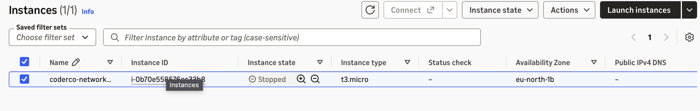
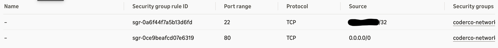

# CoderCo Networking Project — AWS EC2 & NGINX

## Project Overview

This project demonstrates how to deploy a publicly accessible web server using AWS EC2, Ubuntu Linux, NGINX and Cloudflare DNS.

The objective was to apply networking fundamentals in a practical cloud environment, including IP addressing, DNS resolution, SSH, HTTP and firewall configuration.

## Technologies Used

- **AWS EC2:** Cloud-based virtual server
- **Ubuntu Linux:** Server operating system
- **NGINX:** Web server
- **Cloudflare:** DNS management
- **SSH:** Secure remote server administration
- **Git & GitHub:** Version control and project documentation

## Network Architecture

The website uses the following request flow:

Browser → DNS lookup → EC2 public IPv4
Browser → HTTP (port 80) → EC2 → NGINX

Cloudflare DNS resolves the domain to the EC2 instance's public IPv4 address. The browser then connects to the server over HTTP, where NGINX responds with the webpage.

## AWS Configuration

| Component | Configuration |
|---|---|
| EC2 instance | t3.micro |
| Operating system | Ubuntu Server 26.04 LTS |
| AWS region | eu-north-1 (Stockholm) |
| Storage | 8 GiB gp3 EBS |
| Virtual network | Default VPC |
| Public IPv4 | Dynamically assigned |
| Web server | NGINX |

### Security Group Rules

| Protocol | Port | Source | Purpose |
|---|---|---|---|
| SSH / TCP | 22 | My public IPv4 /32 | Secure administration |
| HTTP / TCP | 80 | 0.0.0.0/0 | Public website access |

Restricting SSH to a specific IP address reduces unnecessary exposure, while allowing HTTP traffic makes the website publicly accessible.

## Deployment Steps

### 1. Launch EC2

Created an Ubuntu EC2 instance with a public IPv4 address and configured the required security group rules.

### 2. Connect Using SSH

Protected the downloaded private key:

```bash
chmod 400 ~/Downloads/coderco-networking-key.pem
```

Connected to the server using SSH:

```bash
ssh -i ~/Downloads/coderco-networking-key.pem ubuntu@<EC2-PUBLIC-IP>
```

### 3. Install NGINX

Updated the package list and installed NGINX:

```bash
sudo apt update
sudo apt install nginx -y
```

Verified the service:

```bash
sudo systemctl status nginx
```

The service reported `active (running)`.

### 4. Configure DNS

Created a Cloudflare DNS A record pointing the root domain (`@`) to the EC2 public IPv4 address.

For initial testing, the record used DNS-only mode.

### 5. Verify Deployment

Successfully accessed the default NGINX welcome page through:

- The EC2 public IPv4 address
- The purchased domain name

This confirmed that DNS resolution, security group rules, HTTP connectivity and the NGINX service were functioning correctly.

## Key Networking Concepts

**Public vs Private IP:** The public IP enables internet access to the EC2 instance, while its private IP is used within the VPC.

**DNS:** Translates a human-readable domain name into an IP address.

**SSH:** Provides encrypted remote access to the Ubuntu server using TCP port 22.

**HTTP:** Allows browsers to request webpages from NGINX using TCP port 80.

**Security Groups:** Act as stateful virtual firewalls controlling traffic to and from EC2 instances.

## Challenges and Solutions

### 1. Configuring SSH Access

**Challenge:** Understanding how to securely connect to an EC2 instance from my Mac.

**Solution:** Created an SSH key pair, restricted inbound SSH traffic to my public IPv4 address using a `/32` CIDR rule, and configured the private key permissions using `chmod 400`.

**Learning:** Gained practical experience with SSH authentication, Linux file permissions and security group configuration.

### 2. Navigating the AWS EC2 Console

**Challenge:** Locating instance health checks and networking configuration options within the AWS console.

**Solution:** Explored the EC2 instance details and located the status checks, confirming that all three checks passed.

**Learning:** Understood the importance of verifying instance health before attempting to deploy applications.

### 3. Configuring DNS

**Challenge:** Understanding how to connect a purchased domain name to a cloud-hosted web server.

**Solution:** Created a Cloudflare DNS A record pointing the root domain (`@`) to the EC2 public IPv4 address, using DNS-only mode for initial testing.

**Learning:** Developed a practical understanding of DNS resolution and how domain names map to IP addresses.

### 4. Managing AWS Costs

**Challenge:** Understanding which AWS resources continue to incur charges when not actively being used.

**Solution:** Configured an AWS billing budget and stopped the EC2 instance when testing was complete.

**Learning:** Understood that stopping an EC2 instance prevents further instance compute charges, while storage charges may continue.

## Future Improvements

- Configure HTTPS using TLS certificates
- Deploy a custom HTML webpage
- Use an Elastic IP or another stable endpoint
- Automate deployment and configuration

## Project Outcome

Successfully deployed an NGINX web server on AWS EC2 and connected a custom domain through Cloudflare DNS, demonstrating practical cloud networking and Linux administration skills.

## Project Screenshots

The following screenshots document the AWS EC2 deployment, security group configuration and Cloudflare DNS setup.

### 1. AWS EC2 Instance



### 2. EC2 Security Group



### 3. Cloudflare DNS Configuration

